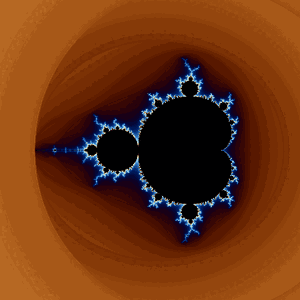
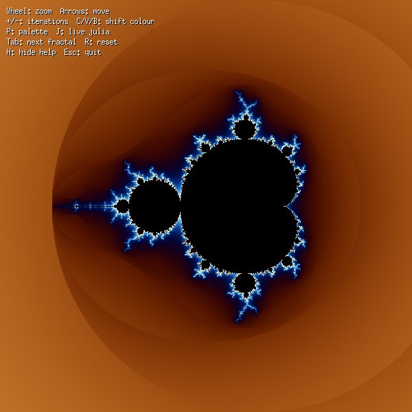
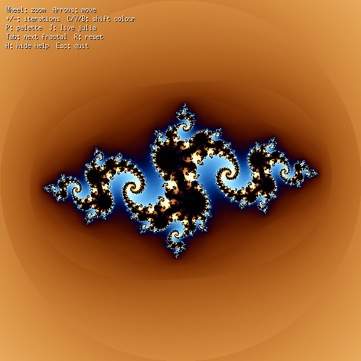
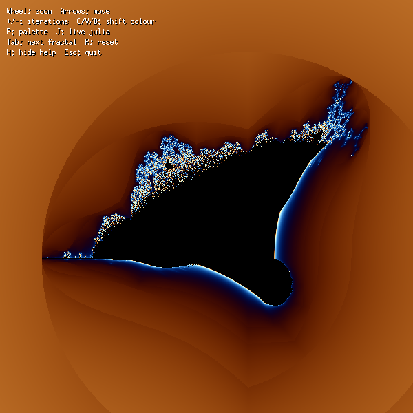
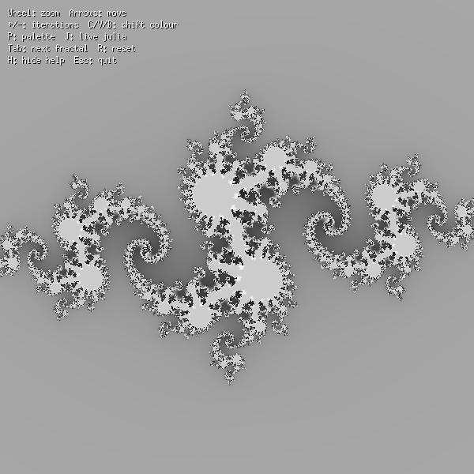

# fractol

> Interactive Mandelbrot and Julia fractal explorer in C with MiniLibX.



## What it does
Renders the Mandelbrot set, Julia sets and the Burning Ship in real time, with zoom to the cursor, a vivid cosine palette (or the classic greyscale one), live Julia mode driven by the mouse and multithreaded rendering.

| Mandelbrot | Julia (-0.8, 0.156) | Burning Ship | Greyscale palette |
|---|---|---|---|
|  |  |  |  |

## What I learned
- Complex-number iteration, smooth (continuous) colouring and pixel-to-plane mapping
- Event hooks (keyboard/mouse/motion) and image buffers in MiniLibX
- Parallel rendering with pthreads (rows split across 8 threads), adaptive iteration count on zoom

## Tech stack
C, MiniLibX (X11), pthreads

## Build & run
Linux with X11 dev libraries (Debian/Ubuntu: `sudo apt install gcc make libx11-dev libxext-dev libbsd-dev`). MiniLibX for Linux is bundled.
```bash
make
./fractol mandelbrot
./fractol julia <real> <imaginary>   # e.g. ./fractol julia -0.8 0.156
./fractol bship
```

## Controls
| Key / mouse | Action |
|---|---|
| Mouse wheel | Zoom in/out at the cursor (iterations grow with zoom) |
| Arrows | Move |
| `+` / `-` | More / fewer iterations |
| `C` / `V` / `B` | Shift red / green / blue |
| `P` | Toggle vivid / greyscale palette |
| `J` | Live Julia: the mouse position sets the Julia constant |
| `Tab` | Next fractal |
| `R` | Reset view (keeps your Julia parameters) |
| `H` | Show / hide on-screen help |
| `Esc` / close window | Quit |

## Structure
`fractol.c` (entry), `parse.c` (arguments), `draw.c`, `color.c`, `hooks*.c`, `init.c` (setup/cleanup), `docs/` (screenshots), bundled `minilibx-linux/`.

---
*Built at 42 Madrid by jgomez-d (Jorge Gomez De Oliveira).*
